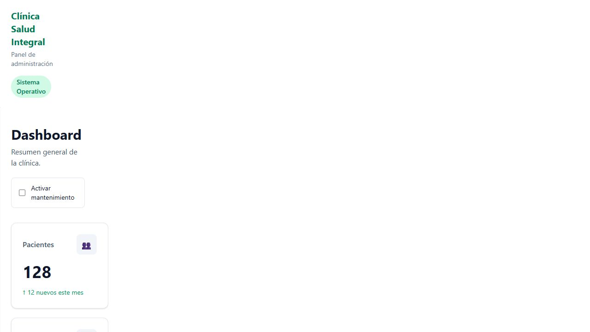
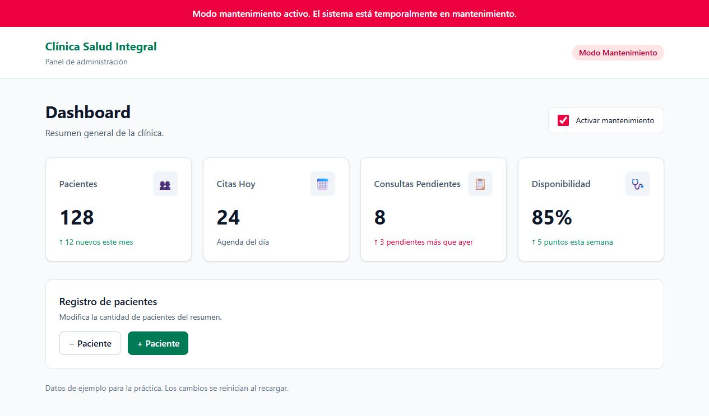

# Clínica Salud Integral — MP2

## Entrega actual — Día 1: datos reales

Dashboard y pacientes conectados al backend Express mediante Axios, con autenticación, CORS, spinner, errores y reintento. [Configuración, implementación, validación y capturas](docs/mp2-dia-1/README.md).

Copiar `.env.example` a `.env.local`, iniciar el backend en `localhost:3000`, ejecutar `npm install` y `npm run dev`, e iniciar sesión en `/login` con una cuenta de recepción.

Las secciones siguientes conservan la documentación histórica del MP1.

SPA de práctica con Vite, React, TypeScript, Tailwind CSS y React Router DOM. Incluye Dashboard, pacientes, detalle, nueva cita y página 404.

## Entrega actual — Día 5

[Recorrido GIF, capturas, explicación de los hooks y pruebas del MP1](docs/dia-5/README.md).

Las páginas se abren desde el sidebar: `/`, `/pacientes` y `/citas/nueva`. Cada paciente tiene su enlace al detalle `/pacientes/:id`. Los datos ficticios se conservan mientras navegas y se reinician al recargar.

## Ejecutar

```bash
npm install
npm run dev
```

Abre la dirección indicada en la terminal. El dashboard es la pantalla inicial `/`.

## Archivos para estudiar

- `src/types/index.ts`: contrato `Metrica` y unión `Tendencia`.
- `src/components/MetricCard.tsx`: recibe una métrica por props y usa `Record<Tendencia, string>` para elegir el color de su descripción.
- `src/components/StatusBadge.tsx`: recibe `activo` y muestra el estado del sistema.
- `src/pages/PaginaDashboard.tsx`: cuatro métricas, estados, botones de pacientes y mantenimiento.
- `vite.config.ts` e `src/index.css`: integración de Tailwind.

Los comentarios del código señalan qué hace cada parte. Las métricas son datos de ejemplo; no se guardan al recargar y no hay backend.

## Validación del día 1

- `npm run build`: ejecuta TypeScript (`tsc -b`) y la compilación de Vite. Correcto.
- `npm run lint`: correcto.
- TypeScript estricto y sin `any` en el código de la aplicación.
- En el navegador: pacientes 128 → 129 al pulsar + y 129 → 128 al pulsar −.
- Mantenimiento: banner rojo y etiqueta “Modo Mantenimiento”; al desactivarlo desaparece el banner y vuelve “Sistema Operativo”.
- El contador impide valores negativos.

## Capturas





## Entrega

Rama: `feat/dia-1-dashboard`. Pull Request hacia `main`; esperar revisión antes del merge.

## Referencias

- https://vite.dev/guide/
- https://tailwindcss.com/docs/installation/using-vite

## Día 2 — Pacientes

La página /pacientes contiene cinco registros de ejemplo, BadgeEstado, PacienteCard y BuscadorPacientes. El buscador tiene estado local y todavía no filtra; filtros y CRUD quedan para el día 3. [Prompt, análisis y capturas del antes y después](docs/dia-2/README.md).

## Día 4 — Nueva cita

La página `/citas/nueva` contiene el formulario con React Hook Form y Zod, carga de médicos con cleanup, errores por campo y confirmación de la cita. [Explicación, pruebas y capturas del día 4](docs/dia-4/README.md).
