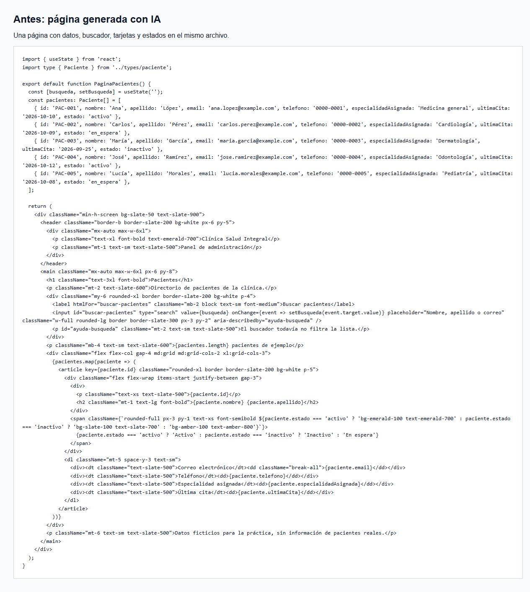
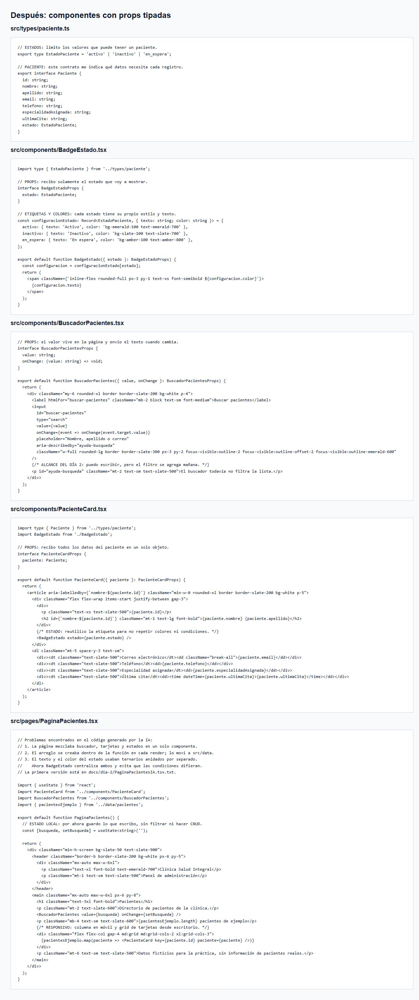
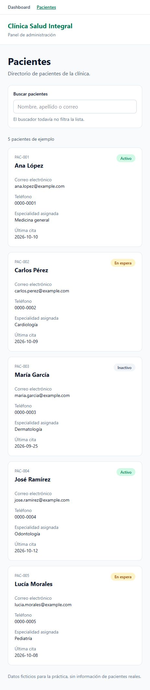
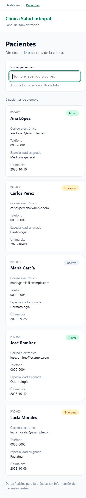

# Día 2 — Pacientes con IA y Tailwind

## Qué hice

Usé Codex como herramienta equivalente de generación con IA. El prompt estructurado está en `prompt.md` y la primera salida se conserva sin refactorizar en `PaginaPacientesIA.tsx.txt`.

Después separé las responsabilidades en:

- `src/types/paciente.ts`: tipos exactos EstadoPaciente y Paciente.
- `src/data/pacientes.ts`: cinco pacientes ficticios, fuera del JSX y del componente.
- `src/components/BadgeEstado.tsx`: etiqueta de estado, colores y textos centralizados.
- `src/components/PacienteCard.tsx`: datos de un paciente y uso de BadgeEstado.
- `src/components/BuscadorPacientes.tsx`: input con props value y onChange tipadas.
- `src/pages/PaginaPacientes.tsx`: estado local y composición de los componentes.

Los tres problemas están comentados al inicio de PaginaPacientes.tsx. Las etiquetas fijas de la interfaz permanecen en JSX; los datos de los pacientes vienen del arreglo.

## Antes y después

Las capturas del código se hicieron en el navegador a partir de vistas HTML que muestran el contenido de los archivos, no capturas inventadas de un editor. El antes corresponde a la primera versión real previa al refactor. La vista visual se conserva casi igual: el cambio principal es la organización del código.









## Validación

- npm run build: correcto; incluye tsc -b.
- npm run lint: correcto.
- Sin any en src ni en vite.config.ts.
- Cinco registros, los tres estados y todos los campos visibles.
- Input controlado: escribí Ana; el valor se actualiza y la lista conserva cinco registros. El filtrado y CRUD corresponden al día 3.
- Móvil a 390 px: flex en columna y sin scroll horizontal.
- Escritorio: clases md:grid md:grid-cols-2 xl:grid-cols-3. El navegador integrado mantuvo un ancho estrecho al solicitar 1280 px, por lo que no se acredita aquí una captura real de escritorio ancho.
- Navegación entre Dashboard y Pacientes comprobada.

## Abrir

```bash
npm install
npm run dev
```

Visitar /pacientes para esta entrega. / conserva el dashboard. Por ahora los enlaces recargan la página; el router de la SPA se puede incorporar cuando corresponda en el curso.

## Rama y dependencia

Rama feat/dia-2-pacientes-lista, PR hacia main. La rama parte del trabajo del día 1 porque el PR #1 todavía está abierto y main conserva la plantilla. El creador indica que el día 1 ya fue aprobado; no se hizo merge automático. Hasta integrar #1, el PR del día 2 también incluye el commit heredado del dashboard. Los dos commits nuevos son los solicitados en el enunciado.

Esperar la revisión del día 2 antes de hacer merge.
