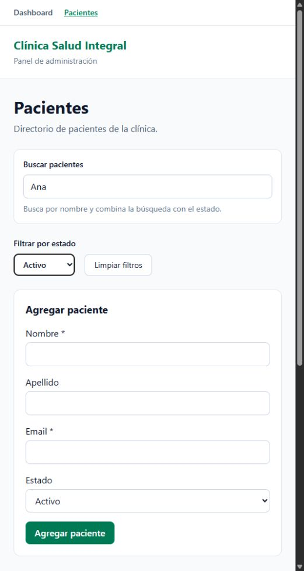
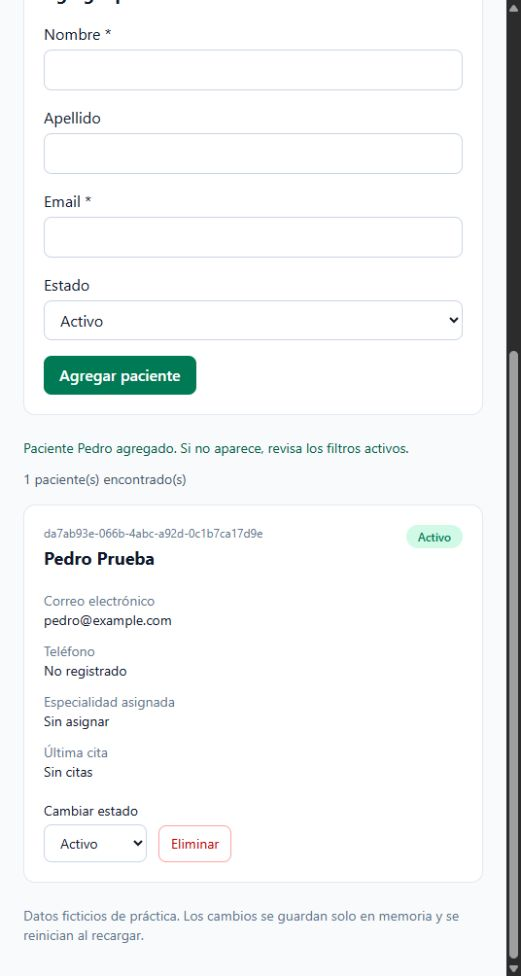
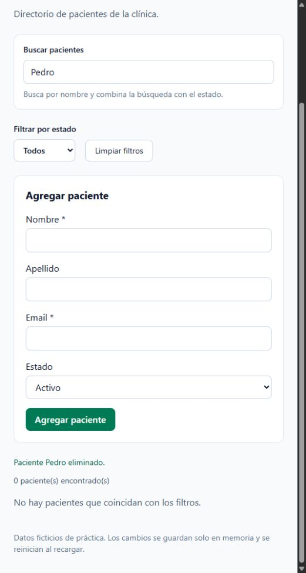

# Día 3 — Pacientes interactivos

Página: `/pacientes`.

- Filtro por nombre (sin distinguir mayúsculas) y estado combinados con AND.
- Limpiar filtros y contador de resultados.
- Formulario controlado con useState; nombre y email obligatorios.
- Altas con spread, cambios de estado con map y eliminación con filter.
- Confirmación con window.confirm antes de eliminar.
- Handlers tipados con ChangeEvent y FormEvent.
- Datos solo en memoria: se reinician al recargar.

## Verificación

Compilación TypeScript y Vite, lint y revisión en navegador: filtros combinados (Ana activa: 1; Ana inactiva: 0), limpiar filtros (5), formulario vacío bloqueado, alta (6), campos limpiados, cambio de estado y eliminación (5).

## Capturas

