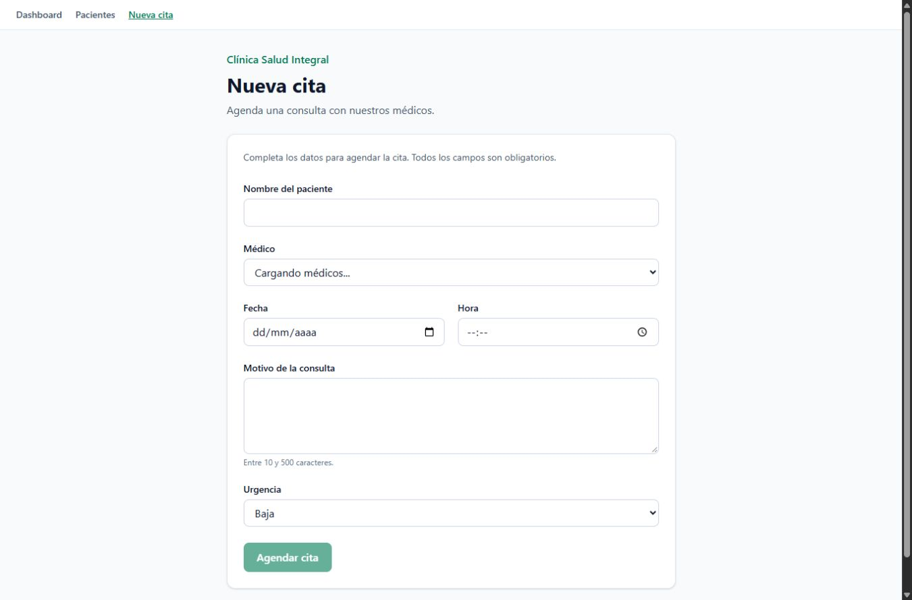
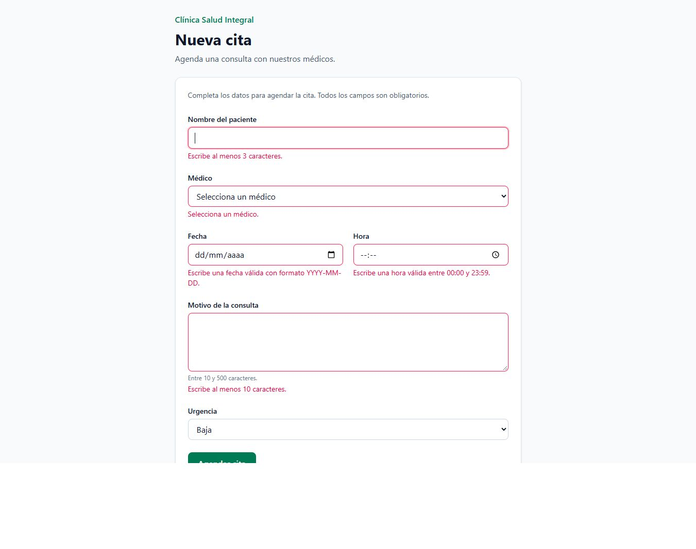
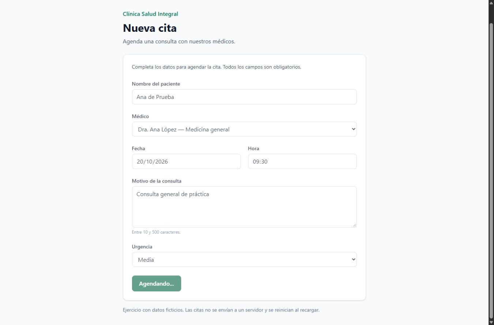
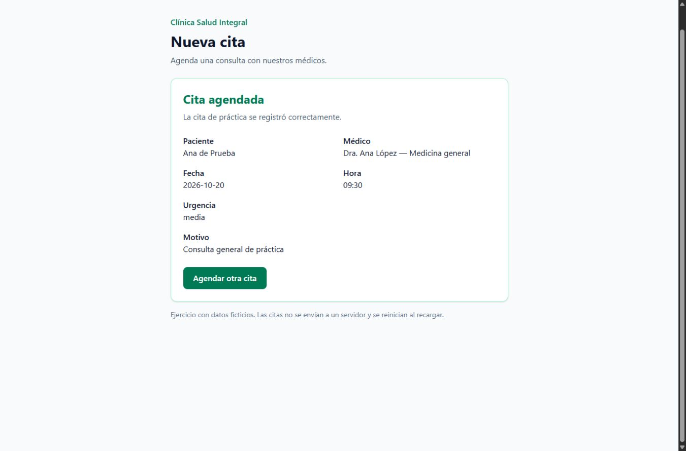

# Día 4 — Formulario de nueva cita

Abro `/citas/nueva` después de ejecutar `npm install` y `npm run dev`.

## Archivos para estudiar

- `src/schemas/citaSchema.ts`: las seis reglas y el tipo obtenido con `z.infer`.
- `src/types/medico.ts`: los datos que tiene un médico.
- `src/hooks/useMedicos.ts`: carga simulada de 800 ms y cleanup con `clearTimeout`.
- `src/components/FormularioCita.tsx`: `useForm`, `register`, `handleSubmit`, `errors`, `isSubmitting` y `reset`.
- `src/pages/PaginaNuevaCita.tsx`: encabezado y formulario.
- `src/App.tsx`: acceso por `/citas/nueva` con el patrón que ya tenía el proyecto. React Router queda para el día 5.

La fecha mínima usa `new Date().toISOString().split('T')[0]`, como pide el enunciado. La calculo con un inicializador de `useState` al abrir el formulario para no llamar a `Date` en cada render. El esquema vuelve a consultar la fecha al validar.

Los médicos y pacientes de las capturas son ficticios. El envío espera 1.5 segundos y guarda la confirmación solo en memoria; no hay backend ni persistencia. “Agendar otra cita” borra los datos y vuelve a urgencia baja.

## Pruebas realizadas

- `npm run build`: TypeScript y Vite sin errores.
- `npm run lint`: sin advertencias.
- Sin `any` en `src`.
- 22 comprobaciones del esquema: datos válidos, nombre corto o espacios, médico vacío, fecha pasada, formato e inexistencia de una fecha, límites de hora y motivo y las cuatro urgencias.
- Navegador: carga de médicos, envío vacío con errores, rechazo de `2000-01-01`, envío con “Agendando...” deshabilitado, confirmación con los seis datos y limpieza al agendar otra cita.
- El hook cancela el timer mediante el retorno del efecto, también bajo StrictMode.

## Capturas de entrega

### Carga de médicos

### Errores visibles

### Envío en curso

### Confirmación

## Rama y revisión

Rama: `feat/dia-4-formulario-cita`, basada en `origin/main` (día 2 integrado). El día 3 se conserva en su rama independiente y no se mezcla en este PR. Esperar revisión antes de hacer merge.

## Referencias

- [React Hook Form: useForm](https://react-hook-form.com/docs/useform)
- [Resolver de Zod](https://github.com/react-hook-form/resolvers#zod)
- [Zod: validaciones](https://zod.dev/api)
- [React: useEffect y cleanup](https://react.dev/reference/react/useEffect)

