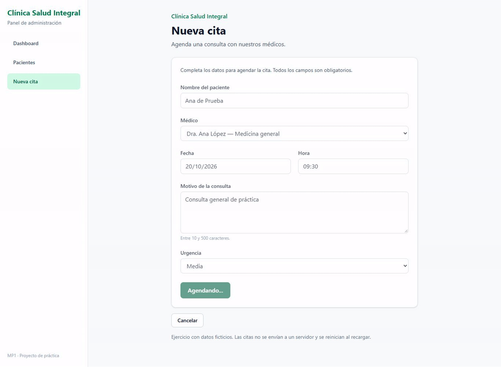
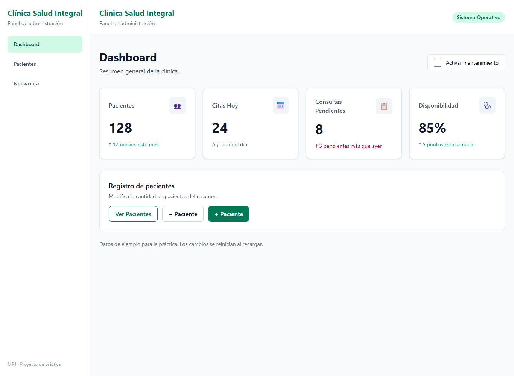
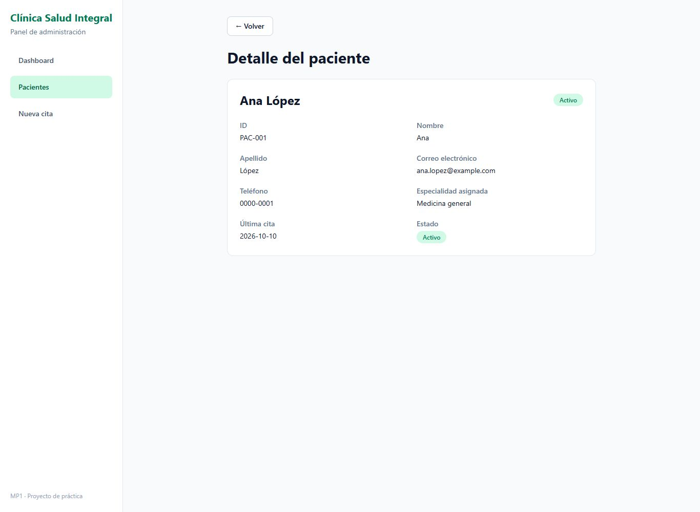
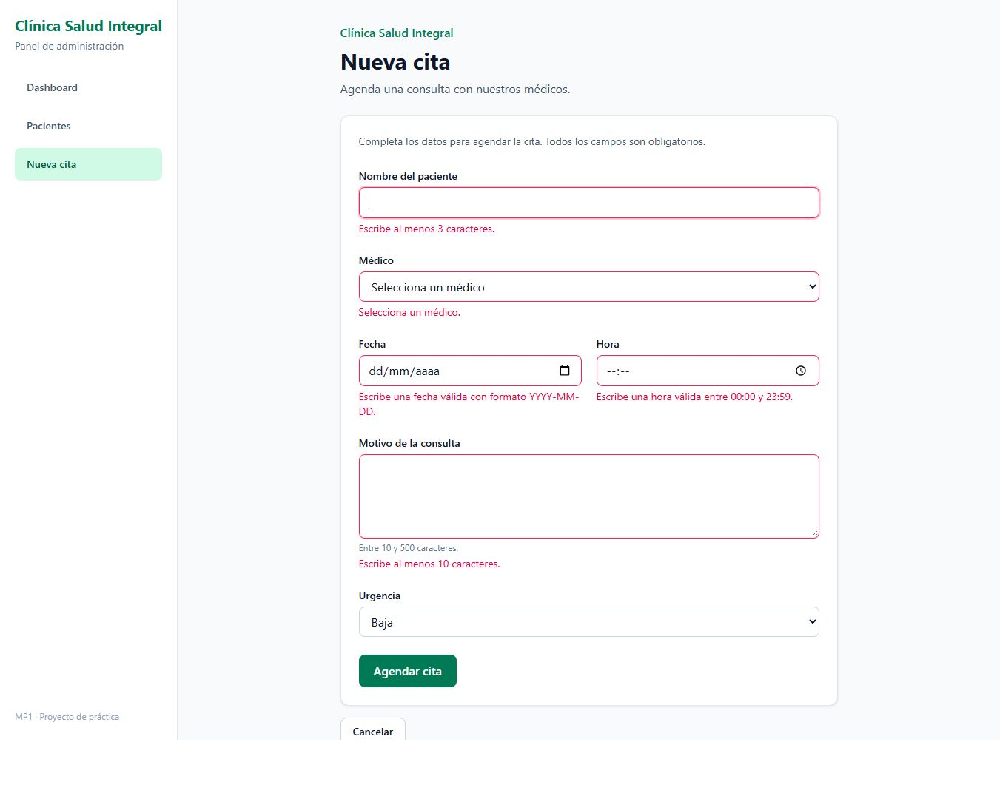
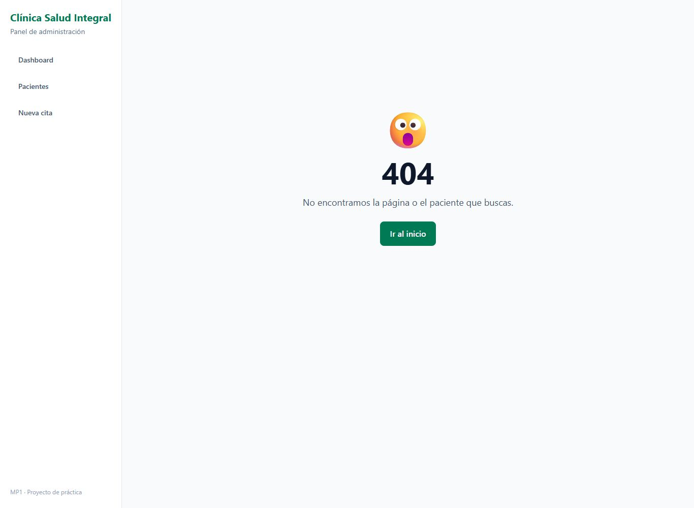
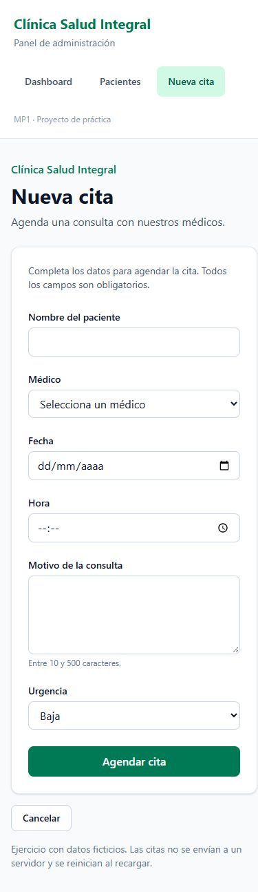

# Día 5 — SPA Navegable Completa (MP1)

Reúno el dashboard, pacientes y nueva cita con React Router DOM. Mantengo los datos de práctica y los componentes de los días anteriores.

## Ejecutar

```bash
npm install
npm run dev
```

Abro la URL que muestra Vite. Las rutas son:

| Ruta | Página |
| --- | --- |
| `/` | Dashboard |
| `/pacientes` | Lista, filtros y formulario de pacientes |
| `/pacientes/PAC-001` | Ejemplo de detalle por ID |
| `/citas/nueva` | Formulario con React Hook Form y Zod |
| Cualquier otra ruta | Página 404 |

## Archivos para estudiar

- `src/main.tsx`: BrowserRouter envuelve la app.
- `src/App.tsx`: las cinco rutas tienen el mismo Layout como padre. También guardo la lista compartida con useState.
- `src/components/Layout.tsx`: NavLink diferencia la sección activa y Outlet muestra cada página. Dashboard usa end para que no quede activo en todas las rutas.
- `src/pages/PaginaDetallePaciente.tsx`: useParams lee el ID, find busca el paciente y useNavigate(-1) vuelve al historial anterior.
- `src/pages/PaginaNotFound.tsx`: reutilizo el 404 para rutas y pacientes inexistentes; Link permite volver al inicio.
- `src/components/PacienteCard.tsx`: Ver detalle usa Link.
- `src/pages/PaginaDashboard.tsx`: Ver Pacientes usa useNavigate.
- `src/pages/PaginaNuevaCita.tsx`: Cancelar usa useNavigate(-1).

Comparto los pacientes usando lo que ya practiqué: useState y props. Así un paciente agregado o actualizado también aparece en el detalle y se conserva al navegar. No hay backend, almacenamiento permanente ni autenticación. Al recargar se recuperan los cinco pacientes iniciales. El contador del dashboard sigue siendo la métrica de práctica del día 1.

## Pruebas realizadas

- Build y lint sin errores ni advertencias; sin any en src.
- Dashboard → Ver Pacientes → Ver detalle → Volver.
- Nueva cita → errores de validación → Cancelar regresa a la lista.
- Sidebar con sección activa en Dashboard, Pacientes, detalle y Nueva cita.
- Crear un paciente ficticio, cambiar su estado con map, abrir su detalle, visitar cita, cancelar y volver a la lista pasando por Dashboard: el registro sigue presente. Esto comprueba que la navegación conserva el estado en memoria.
- Filtros combinados por nombre y estado y eliminación del paciente de prueba.
- Envío de cita con espera, botón deshabilitado y confirmación de éxito.
- Entrada directa a un paciente inexistente y a una ruta desconocida: ambos muestran 404; Ir al inicio abre Dashboard.
- Vista de laptop a 1366 px y revisión móvil a 390 px; en móvil el menú queda arriba.
- Se conservan los botones del contador y mantenimiento del dashboard.

## Recorrido y capturas

El GIF reúne 13 capturas reales tomadas durante la navegación, con dos segundos por paso. Incluye las cinco rutas, retorno, cancelación, validación, envío y confirmación. Para probar el comodín y un ID inexistente escribí esas direcciones directamente; los botones y enlaces de la app navegan con React Router.



### Sidebar y enlace activo



### Detalle de paciente



### Errores del formulario



### Página 404



### Móvil



## Entrega

Rama: `feat/dia-5-spa-completa`. PR hacia main, sin hacer merge hasta recibir revisión. Como main todavía contiene el día 2, esta rama también reúne el trabajo ya existente de los días 3 y 4. Sus ramas y laboratorios permanecen disponibles.

## Referencia

[React Router: rutas, layouts y segmentos dinámicos](https://reactrouter.com/start/declarative/routing).
