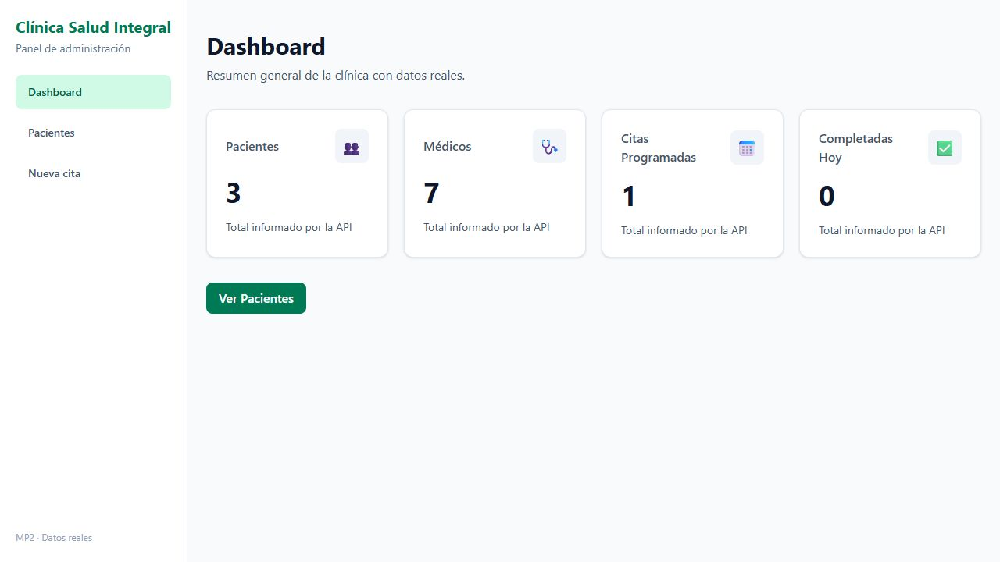
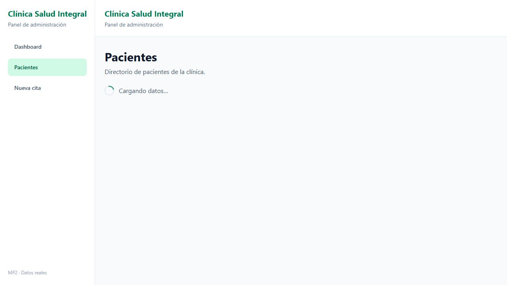
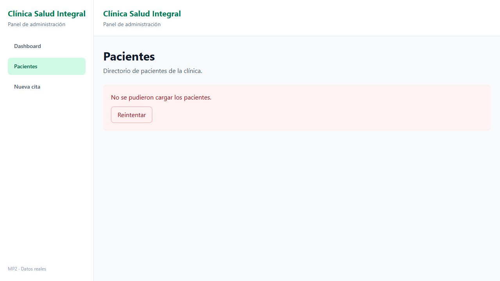

# MP2 — Día 1: datos reales

El dashboard y el directorio usan el backend Express `clinica-salud-integral` de `Proyecto de la Clinica`. El proyecto `catalogo` es una práctica independiente.

## Ejecutar

1. En el backend, conservar su `.env` con PostgreSQL y JWT, ejecutar `npm install`, `npm run build` y `npm start`.
2. En este frontend, ejecutar `npm install`, copiar `.env.example` a `.env.local` y ejecutar `npm run dev`.
3. Abrir `http://localhost:5173/login` e ingresar con una cuenta de rol `RECEPCIONISTA`. El token se obtiene de `POST /api/auth/login`.

No se incluyen cuentas, contraseñas ni tokens en Git. La cuenta local de prueba fue creada con autorización para esta validación.

## Implementación

- `src/lib/axios.ts`: URL desde `VITE_API_URL`, timeout de 8 segundos, token Bearer y redirección a `/login` ante 401. Un 401 del propio login muestra el error de credenciales sin recargar el formulario.
- `src/lib/coleccion.ts`: admite `{ data, total }` o un array plano. El dashboard usa `total` o `length` según corresponda.
- `PaginaDashboard`: consultas en paralelo a pacientes, médicos y citas por estado. Spinner, error y reintento; cancela peticiones al desmontar.
- `usePacientes`: carga la lista real al entrar a las rutas de pacientes y comparte la lista con el detalle. Incluye cancelación, total, carga, error y reintento.
- `src/lib/pacientes.ts`: convierte los IDs numéricos de Express a string para las rutas del MP1 y muestra “Sin información” cuando el backend no ofrece estado, especialidad o última cita. No inventa valores clínicos.
- Se conservan las acciones locales del MP1, claramente indicadas en la página; POST/PUT/DELETE quedan para el día 2. La tarjeta del dashboard y el total registrado siempre representan la respuesta del servidor.

## Ajustes del backend

- CORS permite `http://localhost:5173`, antes de las rutas y de la autenticación.
- Nueva ruta autenticada `GET /api/citas`, disponible para recepción; valida `estado=Programada|Completada` y responde `{ data, total }`.
- `Programada` se traduce al enum `PROGRAMADA`. `Completada` se traduce a `COMPLETADA` y filtra la fecha de la cita al día actual en `America/Guatemala`, para la tarjeta “Completadas Hoy”. El modelo existente no guarda una fecha de finalización independiente.
- Los endpoints de pacientes y médicos siguen devolviendo arrays, por lo que el frontend usa su longitud.

## Verificación

- `npm run build` y `npm run lint` en el frontend.
- `npm run build` en el backend.
- Login con cuenta de recepción y cuatro respuestas HTTP 200. Totales observados: pacientes 3, médicos 7, programadas 1, completadas hoy 0.
- CORS y preflight para Authorization; rutas protegidas responden 401 sin token y estado inválido responde 400.
- Navegador: dashboard, directorio con “3 paciente(s) registrado(s)” y detalle con ID numérico.
- Un proxy local temporal reenvió las respuestas del backend con 4 segundos de demora: spinner visible.
- El mismo proxy simuló 503: se mostró error; al recuperar la conexión, “Reintentar” cargó los 3 pacientes.
- Una respuesta 401 simulada redirigió al login.
- El proxy se detuvo después de las pruebas y la aplicación quedó otra vez conectada directamente a `http://localhost:3000/api`.

[Resultados HTTP sin credenciales ni datos personales](validacion-http.json).

## Captura de Network

Pendiente la captura literal de DevTools Network: el control del navegador de escritorio se interrumpió al no poder verificar la URL. Las capturas anteriores y el registro HTTP prueban la integración, pero no sustituyen esa captura del entregable.

Para obtenerla: abrir el frontend en Chrome, iniciar sesión, pulsar F12, seleccionar Network y Fetch/XHR, recargar el dashboard y capturar las filas de `pacientes`, `medicos`, `citas?estado=Programada` y `citas?estado=Completada` con estado 200. No mostrar headers Authorization ni tokens en la captura.

## Dependencias de la entrega

La rama parte de la SPA del MP1 día 5; los PR anteriores de días 3–5 siguen pendientes. Se abre el PR del MP2 hacia `main` como pide la tarea, sin fusionar los PR anteriores automáticamente.
