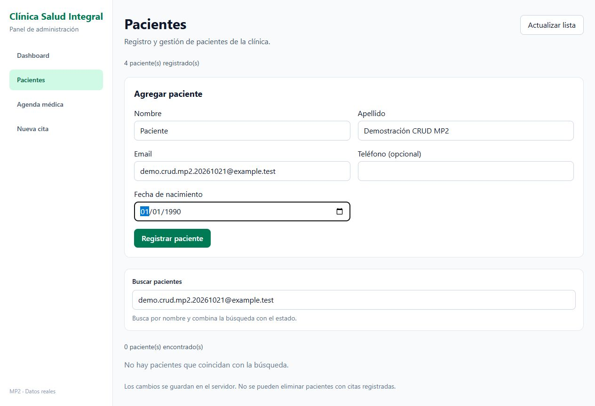
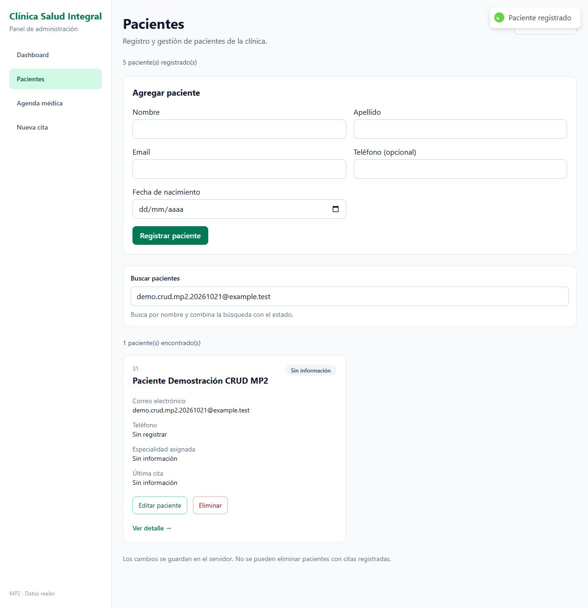
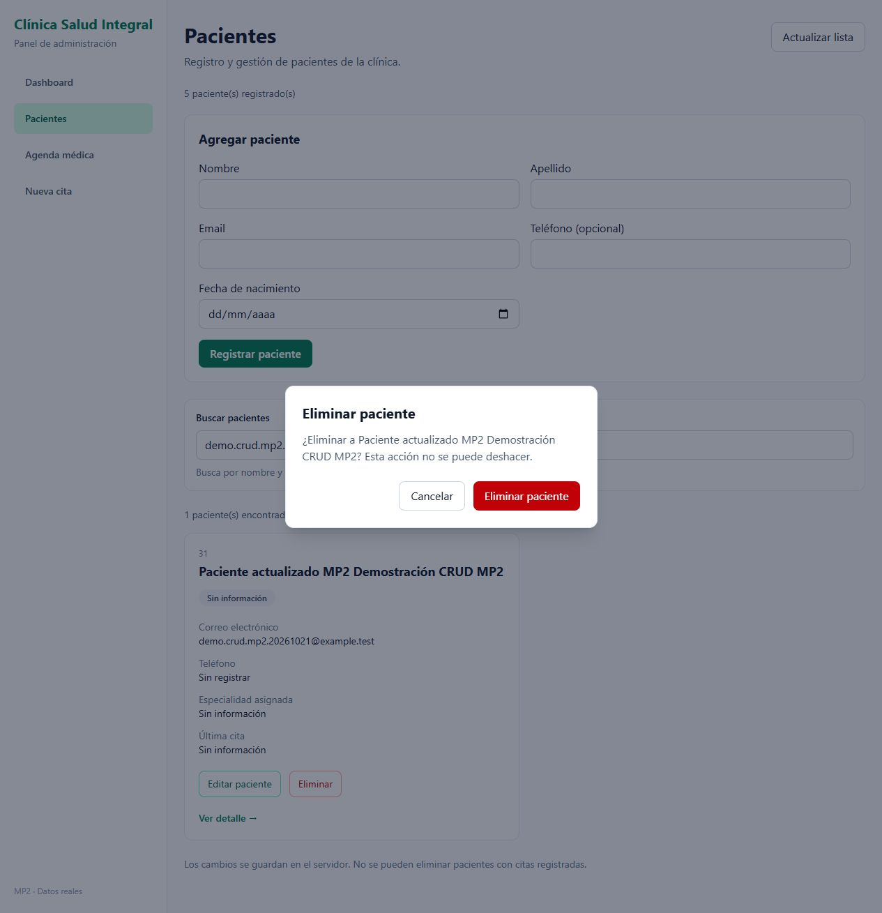
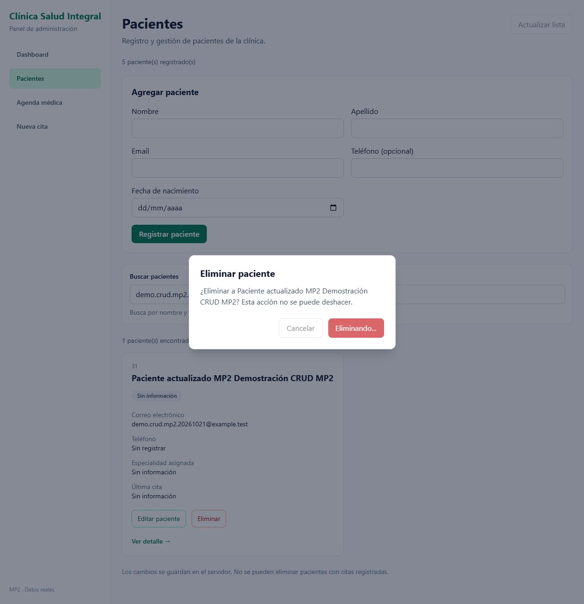
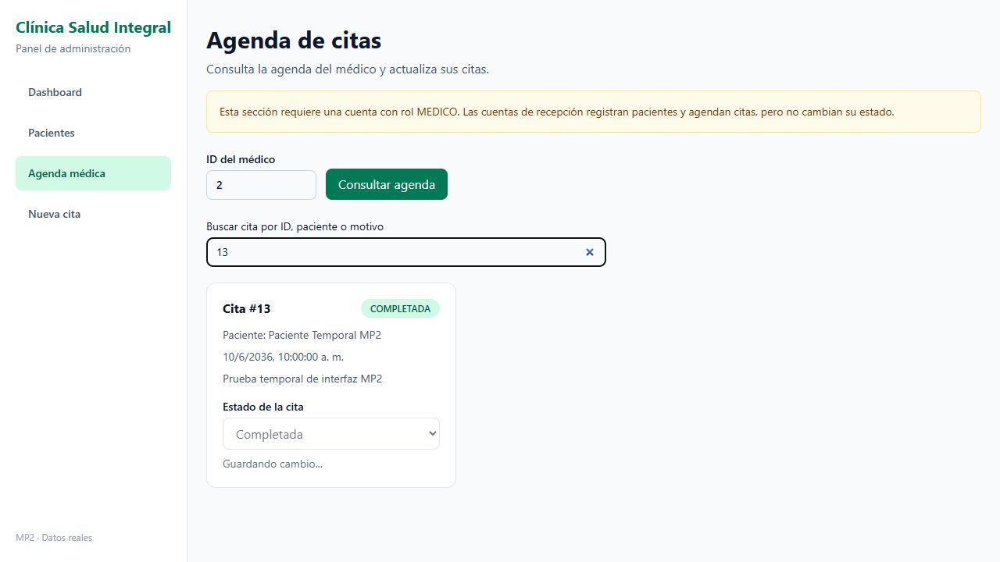
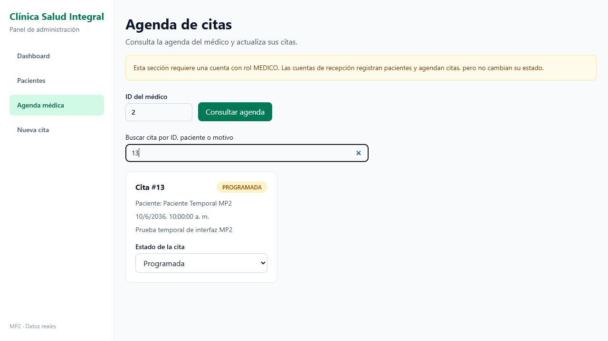
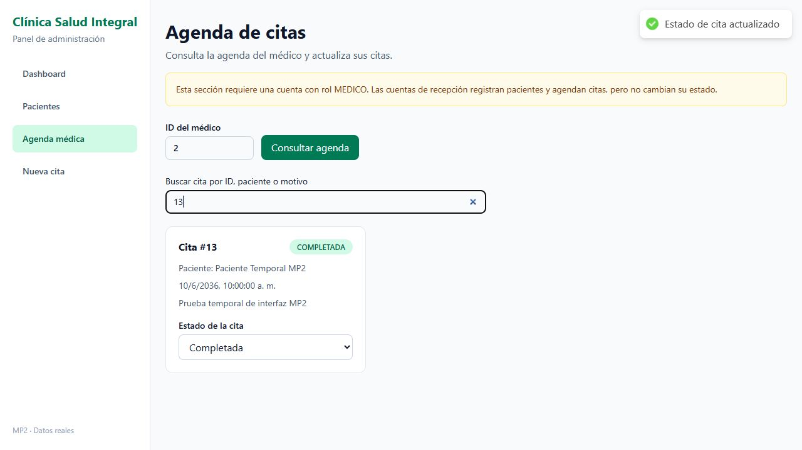

# MP2 — Día 2

Las llamadas HTTP están en `src/services`. Los DTOs usan `Omit` y `Partial`, sin `any`. El backend devuelve el paciente creado dentro de `paciente`, así que el formulario toma ese campo antes de agregarlo a la lista.

## Qué se puede probar

1. Entrar con una cuenta de recepción y abrir Pacientes.
2. Completar el formulario y registrar un paciente. Aparece el aviso “Paciente registrado”, la lista se actualiza y el formulario se limpia.
3. Editar el paciente y guardar. Al actualizar la lista, el cambio sigue guardado.
4. Presionar Eliminar. El modal pide confirmar y muestra “Eliminando...” hasta que responde el servidor. Si sale bien, desaparece de la lista.
5. En Nueva cita, elegir paciente y médico y completar una fecha futura.
6. Entrar con una cuenta de médico, elegir Agenda médica y consultar su ID. Cambiar una cita a Completada o Cancelada: se ve inmediatamente y luego se confirma con un toast.

Se mantienen los permisos que ya tenía el backend: recepción administra pacientes y crea citas; médicos consultan su agenda y cambian estados. Un paciente con citas registradas no se puede eliminar.

## Comprobaciones realizadas

- `npm run build` y `npm run lint` pasan.
- Se probó POST de paciente y cita, PUT de paciente y DELETE desde la interfaz contra Express y PostgreSQL.
- El cambio de estado persistió al volver a consultar la agenda y se confirmó en la base de datos.
- Para comprobar la UI optimista se usó un proxy temporal limitado a `127.0.0.1`: retrasó el PATCH y después devolvió un 503 controlado. Se mostró el cambio inmediato, volvió al valor anterior y apareció “Cambio revertido”. Después se probó el PATCH exitoso contra el servidor real.
- El proxy se retiró al terminar. No forma parte del proyecto.
- El backend pasó 27 comprobaciones específicas de este CRUD y sus 35 comprobaciones de integración existentes.

Los errores de los componentes pasan por `extraerMensajeError`. Se usa la versión simple de la tarea, por eso un error HTTP puede mostrar el mensaje general de Axios.

## Capturas

Todas usan registros ficticios con correos `example.test`. Los datos temporales se retiraron después de verificar las operaciones.

## Dependencias de la entrega

Esta rama continúa el día 1. El PR anterior debe integrarse primero. El backend también necesita los endpoints PUT y DELETE de pacientes incluidos en su PR del día 2.
