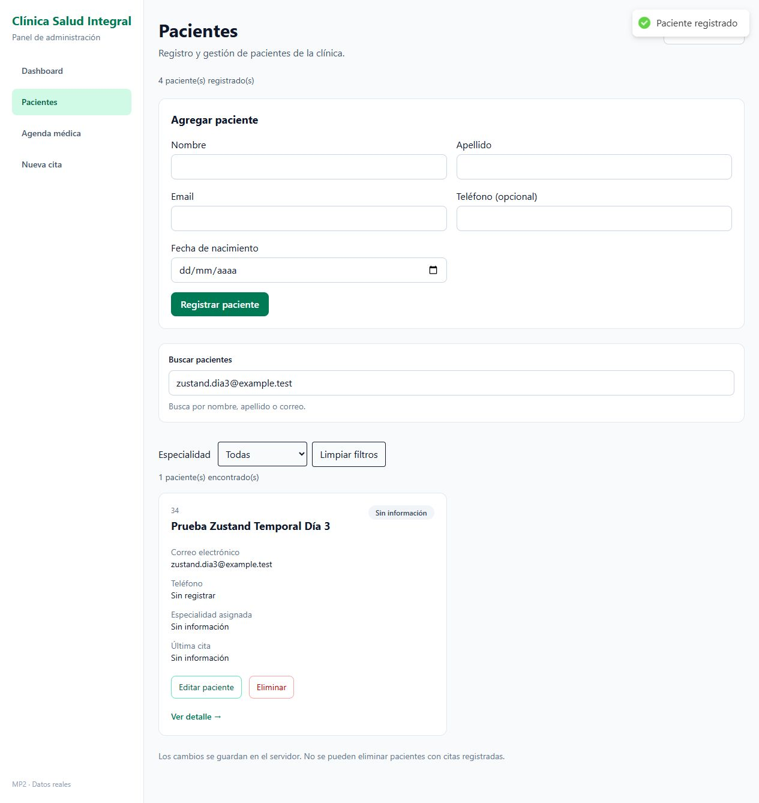
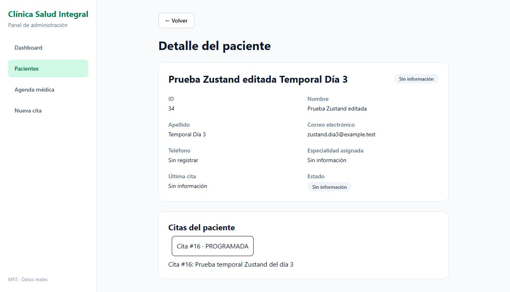

# MP2 — Día 3

## Stores

- `PacientesStore`: lista, total, carga, error y acciones para cargar, crear, actualizar y eliminar.
- `CitasStore`: citas, selección, carga y error. Permite cargar por paciente o por médico, agregar una cita y actualizar su estado.
- `FiltrosStore`: búsqueda de pacientes, especialidad, estado de cita y limpieza de filtros.

Todos están en `src/stores` y tienen `devtools` con acciones nombradas. Solo se habilita en desarrollo. Para médicos y métricas se agregaron dos stores auxiliares, así no queda estado de API en `useState`.

`App` ya no pasa pacientes ni setters por props. La tarjeta elimina con la acción del store y mantiene su propio modal. La edición conserva únicamente el ID como estado de UI. El formulario crea o actualiza desde el store.

La selección de cita usa `find` sobre el array ya cargado. Se puede probar desde el detalle del paciente. No vuelve a consultar la API. Para cargar sus citas se usa `GET /pacientes/:id`, porque el backend ya las incluye en el expediente. La agenda del médico sigue usando su endpoint existente.

La UI optimista del día 2 se mantiene en la tarjeta: el estado confirmado se guarda en Zustand después del PATCH. Si falla, el valor optimista se revierte y aparece el toast.

Las cargas de pacientes y citas ignoran respuestas de consultas anteriores. Los errores de escritura se guardan en el store y se propagan al formulario o tarjeta para mostrar el toast. Un fallo no elimina los registros de la lista.

## Comprobaciones

```bash
npm run build
npm run lint
npm run test:stores
```

Pasaron los tres comandos. Las 29 comprobaciones de stores verifican el CRUD, la conservación de datos ante errores, respuestas fuera de orden, la selección sin HTTP, la actualización de la cita seleccionada y el reinicio de filtros.

El test usa respuestas simuladas de Axios y un conector de prueba que recibe los mensajes del middleware DevTools. Confirma los nombres `PacientesStore`, `CitasStore` y `FiltrosStore`, sin acciones `anonymous`. Esto no reemplaza la captura de la extensión.

También se probó contra Express y PostgreSQL desde la interfaz: registrar y editar un paciente, crear una cita, cargarla en su expediente, seleccionarla y eliminar el paciente después de retirar la cita de prueba. Al ir al detalle y volver mediante los enlaces de la SPA, el filtro conservó su valor. No se usa persistencia en disco; al recargar toda la página los filtros vuelven a su valor inicial.

Se revisó el código para confirmar que las suscripciones usan selectores y que `useState` queda para formularios y UI. La inspección visual en React DevTools sigue pendiente.

## Captura de Redux DevTools pendiente

El navegador integrado disponible no expone las extensiones. Falta tomar y adjuntar la captura real del historial antes de entregar:

1. Abrir `http://localhost:5173` en Chrome o Edge con Redux DevTools instalado y ejecutar la app con `npm run dev`.
2. Abrir las herramientas del navegador y la pestaña Redux.
3. En el selector de instancias elegir `PacientesStore`. Entrar a Pacientes y actualizar la lista: aparecen `pacientes/cargar` y `pacientes/cargarExito`.
4. Elegir `FiltrosStore`, escribir una búsqueda y limpiar los filtros. Aparecen `filtros/setQueryPacientes` y `filtros/resetFiltros`.
5. Elegir `CitasStore`, abrir el detalle de un paciente y seleccionar una cita. Aparecen `citas/cargarPorPaciente`, `citas/cargarExito` y `citas/seleccionar`.
6. Guardar capturas del historial de las tres instancias y agregarlas al PR. Usar únicamente registros ficticios; el estado del store puede incluir datos del resto de la lista.
7. En React DevTools revisar que las páginas ya no reciben arrays ni setters de pacientes o citas por props.

Referencia: [middleware devtools de Zustand](https://zustand.docs.pmnd.rs/reference/middlewares/devtools).

## Capturas de la interfaz

Solo contienen el paciente y la cita ficticios creados para esta prueba. Ambos se retiraron al terminar. Son evidencia de la interfaz, no de Redux DevTools.





## Entrega

La rama continúa desde el día 2 y el PR apunta a `main`. Primero deben integrarse los PR anteriores. Este día no necesita cambios nuevos en el backend.
