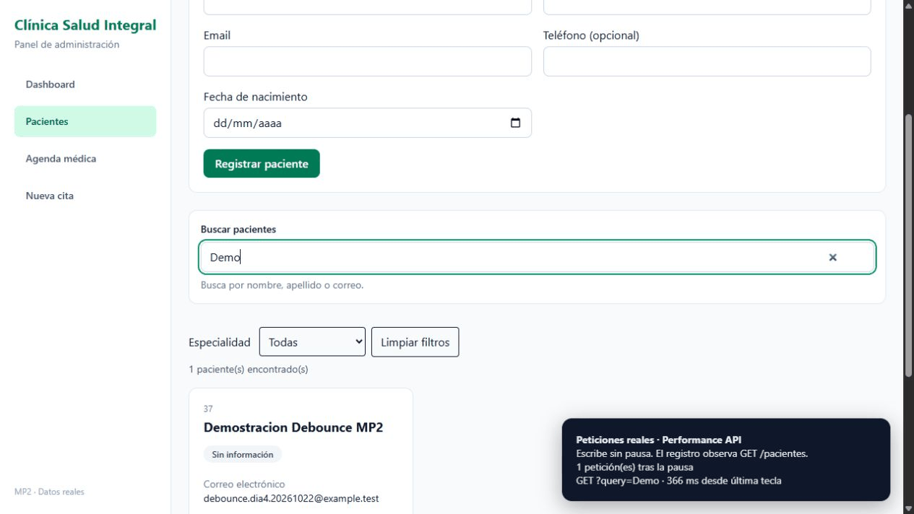
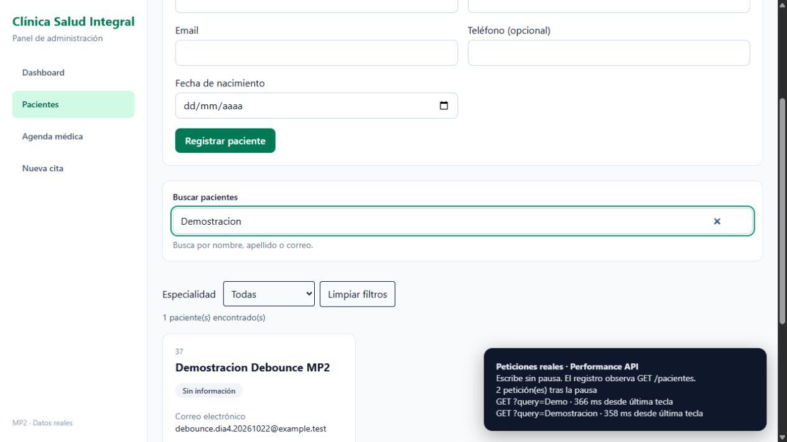
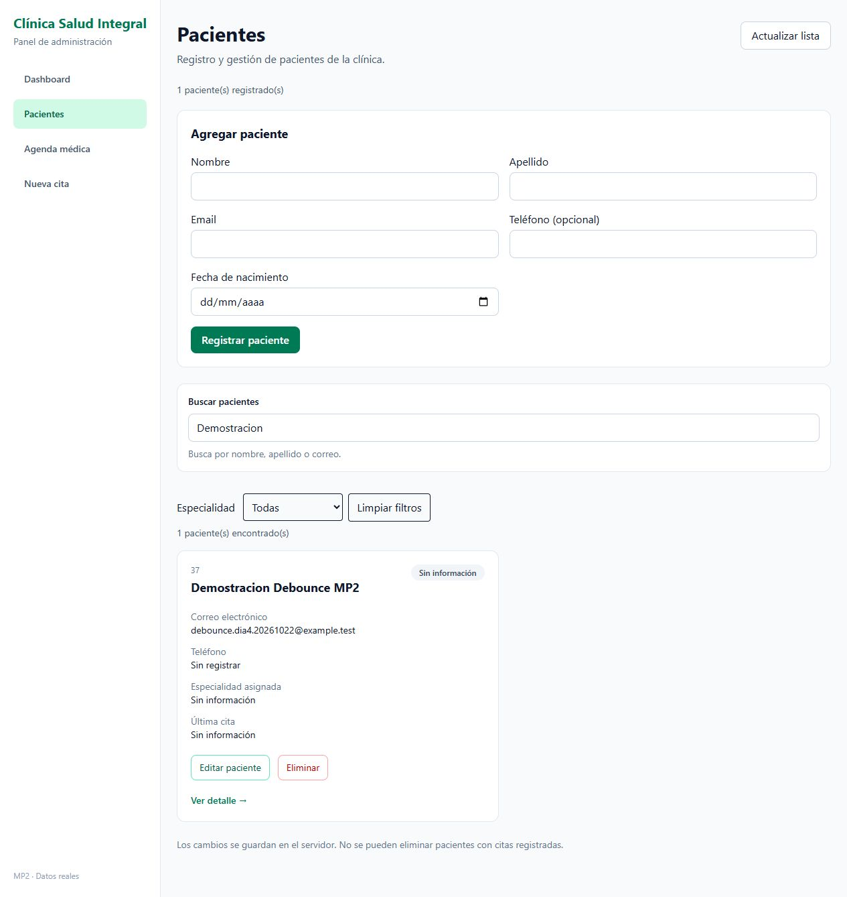

# MP2 — Día 4

## Qué cambió

- `useDebounce<T>` espera 350 ms por defecto y limpia el timeout al cambiar el valor o desmontar.
- `useApi<T>` devuelve datos, carga, error y recarga. Se usa para el expediente del paciente. Su cleanup aborta la petición y evita actualizar el estado después de salir de la página. La función de consulta usa `useCallback` para mantenerse estable entre renders.
- `RespuestaPaginada<T>` tipa la petición real de búsqueda: `data`, `total`, `pagina` y `totalPaginas`.
- El input lee y escribe directamente en `FiltrosStore`. La página consulta con el valor pausado y mantiene el input visible durante la carga, con un spinner dentro.
- Al cambiar de búsqueda o salir de la lista se cancela la consulta anterior. El store también ignora respuestas de consultas anteriores.
- La búsqueda vacía carga la lista sin filtrar. Hay controles para las páginas de 12 resultados.
- “Limpiar filtros” llama a `resetFiltros`. Los valores se conservan entre rutas sin usar localStorage.

El backend necesita el cambio del día 4: antes ignoraba `query`. Ahora busca por palabras en nombre, apellido y correo, sin distinguir mayúsculas. Si se solicitan `pagina` y `limite`, devuelve el objeto paginado. Las consultas anteriores sin paginación conservan su respuesta de array.

## Pruebas

```bash
npm run build
npm run lint
npm run test:stores
```

Los comandos pasan, sin `any` en `src`. Las 29 comprobaciones de stores siguen pasando. El backend pasó 14 solicitudes de búsqueda, paginación, validación y compatibilidad, además de las 27 comprobaciones del CRUD anterior.

Desde la interfaz se comprobó búsqueda, ausencia de resultados, limpieza de filtros, detalle y regreso con la misma búsqueda. La consola no mostró errores. Se usó un paciente ficticio con correo `example.test`, eliminado al terminar.

## GIF y medición real



El GIF reúne 40 capturas reales del navegador, conservando el intervalo entre capturas y una pausa final para leer. El panel inferior es instrumentación temporal basada en `PerformanceObserver`, no la pestaña Network de Chrome. Observa las peticiones reales del navegador y muestra la diferencia entre la última entrada de texto y el inicio de cada petición.

La consulta inicial “Demo” salió 366 ms después de la entrada. Al completar “Demostracion” se agregó una sola petición, iniciada 358 ms después de la última tecla. No hubo peticiones por las letras intermedias. El margen sobre 350 ms corresponde al procesamiento del navegador.

La instrumentación está en `instrumentacion-demo.ts` como referencia. Se importó temporalmente para grabar y después se retiró de la app; no se ejecuta en el producto ni cambia las respuestas de la API.





## Cómo repetirlo en Network

1. Iniciar backend y frontend y entrar con una cuenta de recepción.
2. Abrir Pacientes y F12 → Network → Fetch/XHR. Filtrar por `pacientes` y limpiar el historial inicial.
3. Escribir una palabra sin pausas mayores de 350 ms. Debe aparecer una sola consulta al terminar, con `query`, `pagina` y `limite` en la URL.
4. Entrar al detalle y volver con el botón de la app. El texto del buscador sigue activo.
5. Limpiar los filtros. Después de la pausa se consulta con `query` vacía.

La persistencia pedida es entre rutas de la SPA; recargar toda la página reinicia los stores.

## Entrega

La rama continúa desde el día 3 y apunta a `main`. Primero deben integrarse los PR anteriores. El PR del backend del día 4 se enlaza desde el del frontend.
