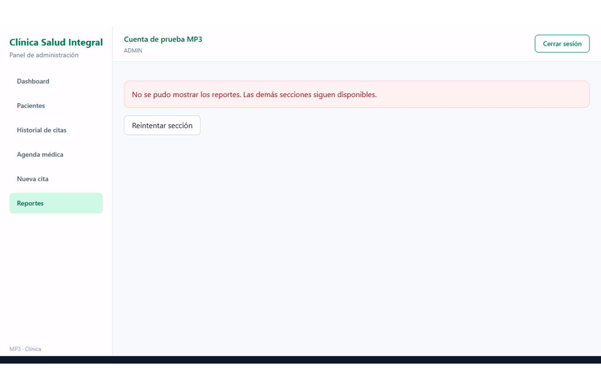

# MP3 — Día 5: robustez y UI compartida

## Implementación

- `src/shared/components/ui/`: AlertaBanner (info, exito, advertencia y error), EstadoVacio con acción opcional, ModalConfirmacion con carga y foco accesible, Spinner inline/fullscreen.
- Modal compartido usado para eliminar pacientes y confirmar estados de cita. Spinner usado en login, perfil, modal y el adaptador Cargando.
- SkeletonMetricCard, SkeletonPacienteRow y SkeletonCitaRow; esqueletos adicionales para formulario y expediente. Se reemplazan las cargas genéricas de dashboard, pacientes, agenda, expediente y formulario de cita; reportes conserva sus esqueletos de gráficas.
- ErrorBoundary por página dentro de Layout. Un error de Reportes mantiene menú y sesión; se puede navegar o reintentar la sección.
- Estados vacíos en pacientes, historial, expediente, agenda y reportes.
- Historial en `/historial?paciente=1&estado=Todos&pagina=2`: filtros antes de paginar, seis citas por página, URL normalizada, F5 y navegación atrás/adelante. La API existente entrega las citas en el expediente del paciente; la paginación del historial se realiza sobre esa respuesta.
- Se conservan auth persistente, Bearer, manejo de 401, rutas por rol y foto con preview y validación.

## Validación

`npm run build`, `npm run lint`, `npm run test:auth`, `npm run test:rutas`, `npm run test:perfil`, `npm run test:stores`, `npm run test:reportes` y `npm run test:mp3` pasan. No hay `any` en `src/`. Build tiene una advertencia de tamaño del bundle de Recharts.

Prueba manual mediante `node scripts/qa-mp3.mjs`, en `http://127.0.0.1:5186`: backend HTTP simulado, datos ficticios y token sin validez fuera de QA. Cuenta ADMIN: `mp3@example.test`; recepción: `recepcion@example.test`. Clave de ambas: `ClaseMP3!2026` (solo QA). La demora de lectura de 2.2 segundos permite observar los skeletons. Este servidor y la inyección de fallo no se incluyen en el build.

Verificado en navegador: login → dashboard → pacientes → perfil → historial → logout; F5 conserva sesión; sin sesión `/perfil` redirige a `/login`; recepción recibe SinAcceso en reportes; modal se puede cancelar; historial filtra y actualiza página en URL; expediente sin citas muestra EstadoVacio. `/reportes?qaError=1` provoca un fallo solo en QA y permite seguir navegando.

## Evidencias

- [Skeleton dashboard](02-skeleton-dashboard.png), [pacientes](04-skeleton-pacientes.png), [historial](08-skeleton-historial.png).
- [Paginación y URL visible en la barra de QA](09-paginacion-url.png).
- [Boundary aislando Reportes](10-error-boundary.png).
- [Headers de peticiones HTTP de QA](11-headers-http-qa.png).
- [Estado vacío](12-estado-vacio.png), [logout](13-logout.png), [restricción por rol](14-rol-sin-acceso.png).

El GIF es una secuencia de capturas del recorrido real de QA, no una grabación continua. La barra inferior muestra la URL observada y etiqueta los datos ficticios.

## Pendiente para una entrega estricta

La imagen de headers proviene de un inspector HTTP local y **no** de Chrome DevTools Network. Si el docente exige ese panel exacto, reemplazar o complementar esa imagen con Network → petición `/pacientes` → Headers → Authorization, ocultando el token real. También conviene repetir el recorrido con la cuenta/API de evaluación; las evidencias actuales usan QA ficticio y no prueban disponibilidad del servidor real.
