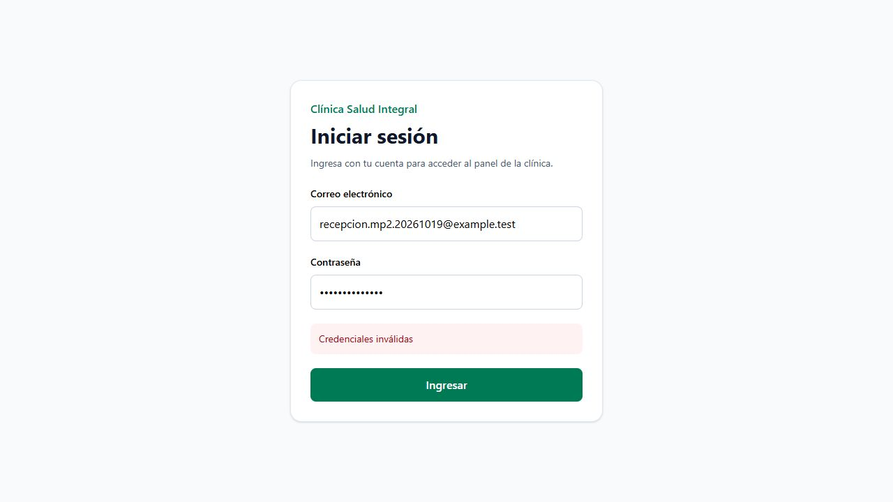
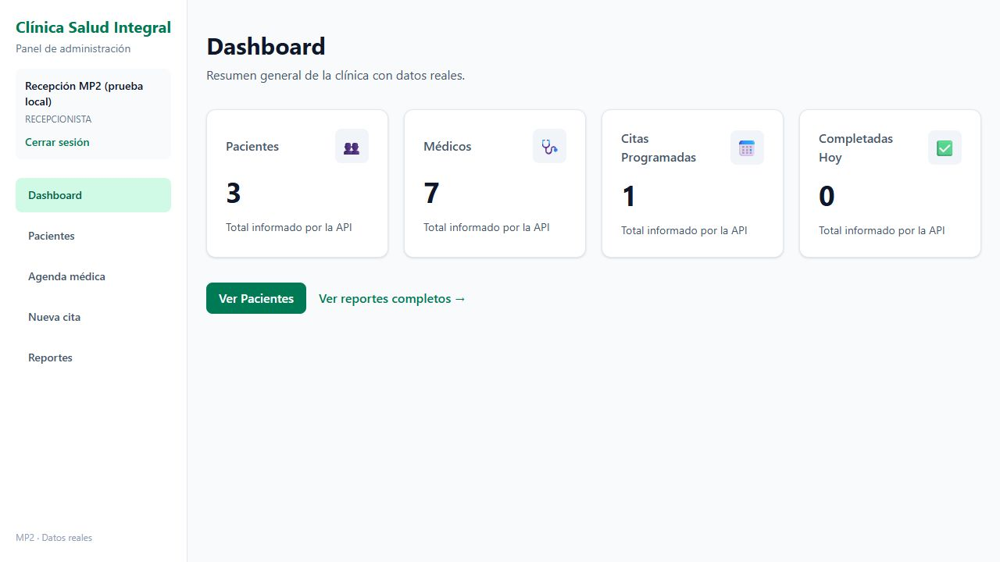

# MP3 — Día 1

El login usa React Hook Form y Zod. Si las credenciales son correctas, guarda el token y el usuario en Zustand con persist y abre el dashboard. La contraseña no se guarda.

Axios toma el token del store y lo manda como Bearer. Si recibe un 401 con una sesión iniciada, cierra la sesión y vuelve al login. Cuando el error viene del formulario de login, muestra el mensaje para poder corregir los datos.

## Comprobaciones

- Login real con la cuenta local de recepción.
- Mensaje de credenciales incorrectas.
- Sesión conservada después de recargar la página.
- Cierre de sesión desde el menú.
- `npm run test:auth`: 18 comprobaciones de validación, persistencia, Bearer y manejo del 401.
- Backend: 14 comprobaciones con usuario temporal, incluyendo token vencido. El usuario temporal se elimina al terminar.
- `npm run build` y `npm run lint`.

El backend debe devolver `{ token, usuario: { id, nombre, email, rol } }` en `POST /auth/login`.

## Capturas

