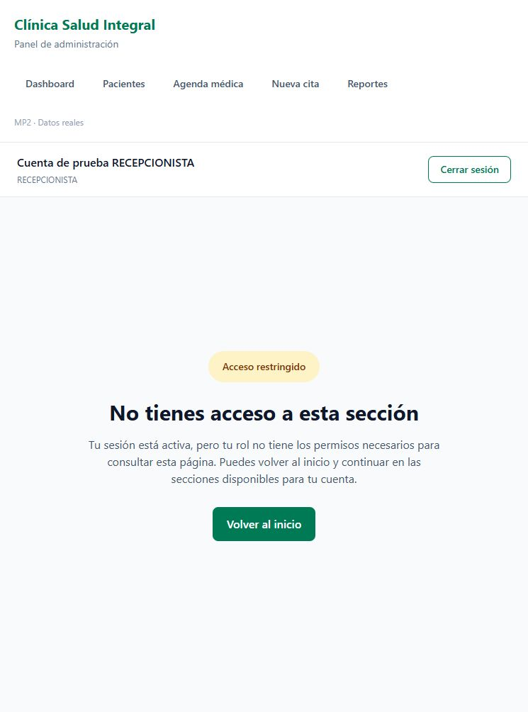
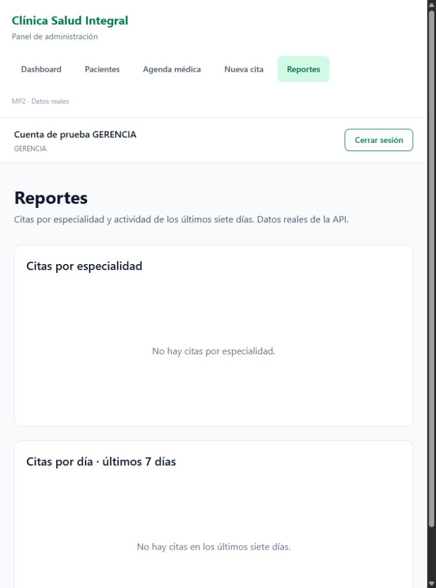
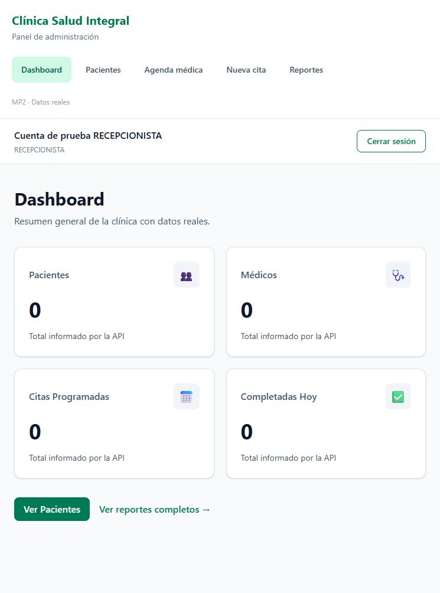
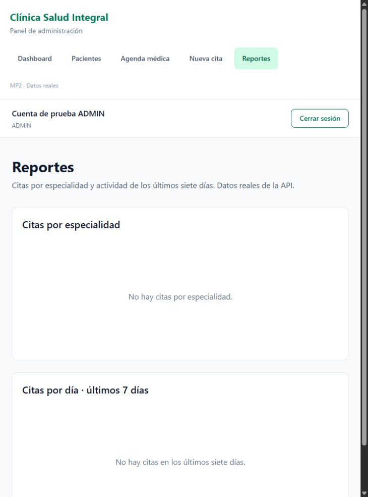
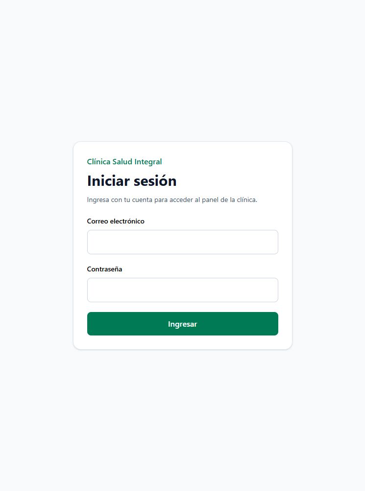

# MP3 — Día 2: rutas protegidas por rol

El PR del día 1 (#10) fue fusionado antes de crear `feat/mp3-dia2-rutas-protegidas` desde `main`. Commit de fusión: `cbd127ac278924e280cd78950811f9897183be5e`.

## Cambios

- `RutaProtegida` centraliza la verificación de sesión y acepta `rolesPermitidos?: string[]`.
- Sin sesión completa redirige a `/login` con `replace`; un rol no autorizado va a `/sin-acceso` con `replace`. Cuando el acceso es válido devuelve `Outlet`.
- `App.tsx` deja solo `/login` pública. Un guard exterior protege todas las demás rutas; un guard anidado permite `/reportes` únicamente a GERENCIA y ADMIN.
- `PaginaSinAcceso` explica el permiso insuficiente y ofrece «Volver al inicio». No redirige automáticamente.
- El encabezado del Layout muestra el nombre y rol del store. «Cerrar sesión» limpia Zustand y navega con `navigate('/login', { replace: true })`.

## Verificación

- `npm run test:rutas`: 13 comprobaciones de contenido protegido, roles, sesión incompleta, lista de roles vacía, pantalla sin acceso y logout.
- `npm run test:auth`: 18 comprobaciones de autenticación del día 1.
- `npm run build`: TypeScript y producción sin errores. Se mantiene el aviso previo de tamaño del bundle.
- No se añadió `any`; no hay usos de `any` en `src`.
- En navegador, sin sesión: `/`, `/pacientes`, `/pacientes/1`, `/citas`, `/citas/nueva`, `/reportes`, `/sin-acceso` y una ruta desconocida terminan en `/login`.
- RECEPCIONISTA no entra a reportes y puede volver manualmente al dashboard. GERENCIA y ADMIN acceden a reportes. Logout vuelve al login y las rutas vuelven a estar bloqueadas.

Las capturas verifican los guards del frontend con **sesiones ficticias y respuestas vacías de API**, usando exclusivamente `node scripts/preview-rutas.mjs` en el puerto 5180. Esta herramienta no se importa en la aplicación, no se incluye en `dist` y no consulta ni modifica el backend real. Las pruebas no sustituyen los controles de autorización del servidor.

## Evidencia

### Intento de acceso sin autenticación

### Rol incorrecto: RECEPCIONISTA

### Acceso autorizado: GERENCIA

### Ruta general para RECEPCIONISTA

### Acceso autorizado: ADMIN

### Cierre de sesión

