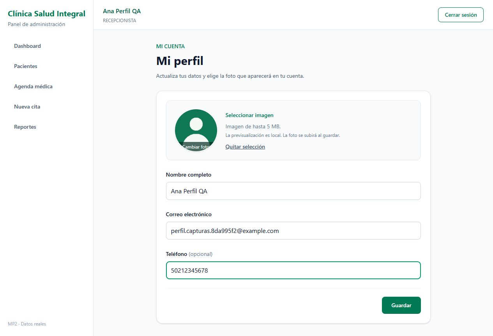
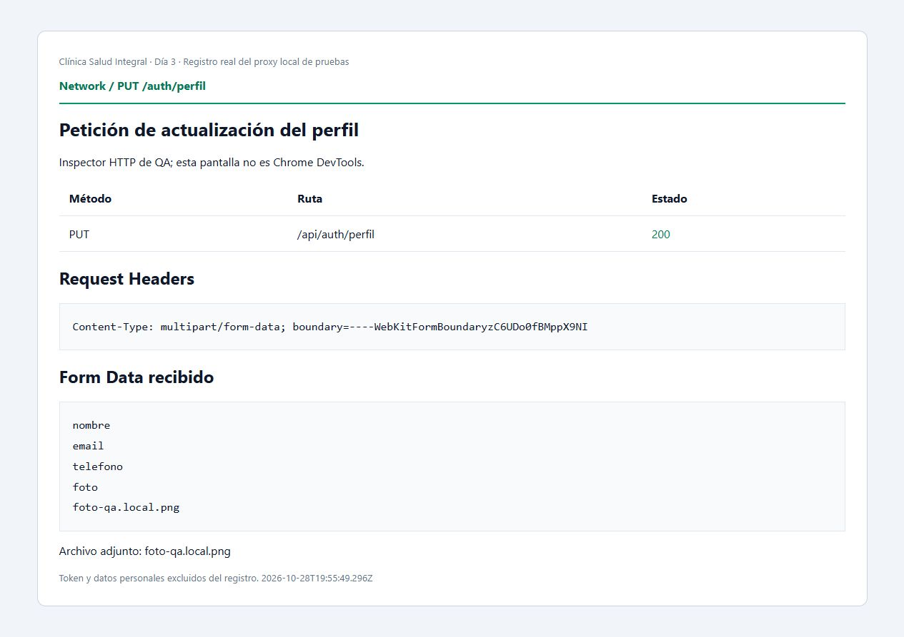
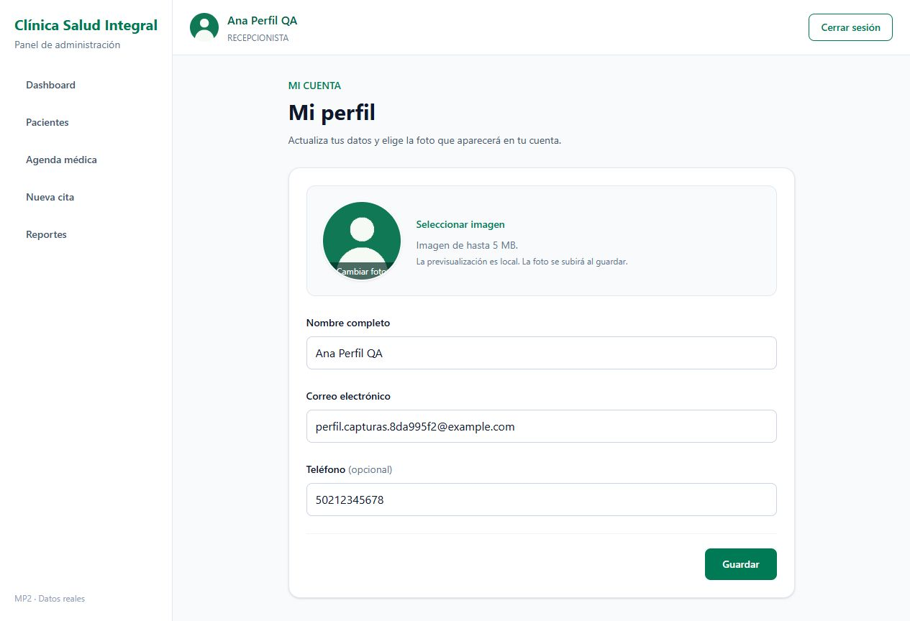
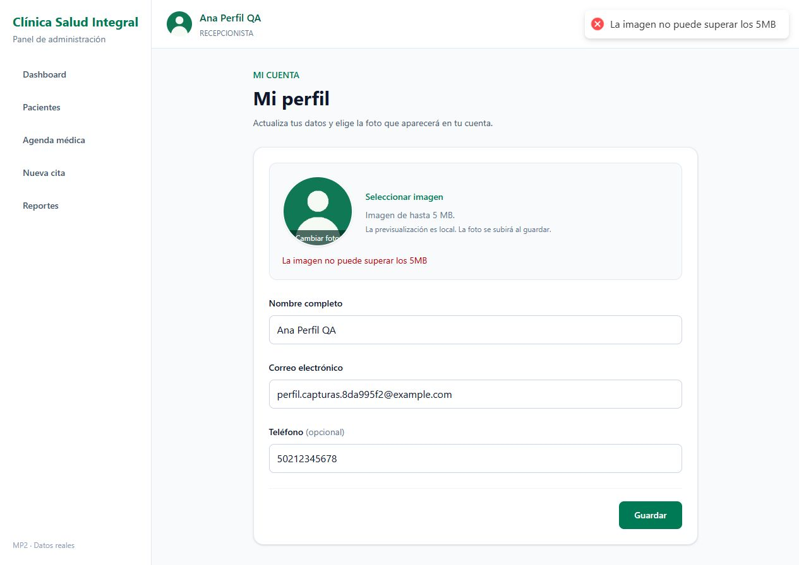

# MP3 · Día 3 — Perfil con foto

Continúa el PR #11 del Día 2, ya fusionado en main.

## Implementación

- Ruta privada `/perfil` y nombre del usuario como enlace desde el header.
- `InputFotoPerfil`: foto existente o placeholder, input oculto, validación image/* y máximo 5 MB. Previsualización inmediata con `URL.createObjectURL`; libera la URL al reemplazar la selección y al desmontarse.
- React Hook Form + `perfilSchema` de Zod: nombre de al menos 3 caracteres, email válido y teléfono opcional de 8 a 15 dígitos. El teléfono vacío es válido.
- `PUT /auth/perfil` recibe FormData con nombre, email, telefono y foto opcional. El navegador genera el boundary; Axios no fuerza JSON.
- Guardar se deshabilita durante el envío. Éxito actualiza y persiste el usuario de Zustand; los errores usan `extraerMensajeError` y toast.
- Se envía telefono vacío para permitir borrar uno anterior. Guardar sin seleccionar foto conserva la existente.

## Verificación

- `npm run build`: correcto; se conserva la advertencia anterior de bundle mayor a 500 kB.
- `npm run lint`: correcto.
- `npm run test:perfil`: 22 comprobaciones de Zod, FormData, servicio y store.
- `npm run test:auth`: 18 comprobaciones; el entorno Windows/OneDrive emite un aviso EPERM al limpiar una caché de Vite, sin fallar las aserciones.
- `npm run test:rutas`: 13 comprobaciones.
- Backend complementario: 20 comprobaciones reales con usuario temporal, multipart, archivos, autenticación y persistencia.
- Navegador contra PostgreSQL y backend reales: login, previsualización antes del envío, guardado, actualización del avatar del header, persistencia al recargar y rechazo local de imagen >5 MB.
- Sin `any` en los archivos TypeScript agregados.

## Capturas

**Límite de la evidencia de red:** la captura 02 corresponde a un inspector HTTP de QA que registra la petición real del navegador a través de un proxy local. No es una captura del panel Network de Chrome DevTools. El control nativo de Chrome no pudo verificar su URL. Para cumplir literalmente ese formato solicitado por la clase, se debe añadir también una captura manual de DevTools → Network → perfil → Headers.

`peticion-multipart.json` contiene los metadatos de la petición real, sin Bearer ni valores personales. El inspector se ejecuta con `node scripts/evidencia-perfil.mjs`, escucha en 5197 y reenvía `/api` al backend local 5195. No forma parte del build de producción.

## Backend requerido

El backend anterior no exponía el endpoint. El [PR complementario #15](https://github.com/dariomartinez2014/clinica_salud_integral/pull/15), rama `feat/mp3-dia3-perfil-api`, en `clinica_salud_integral` agrega la ruta protegida, persistencia de telefono/foto, validación de contenido y tamaño y login con el perfil actualizado. Aplicar su migración y regenerar Prisma antes de usarla.

Para la prueba aislada se usaron backend 5195 y frontend 5196/QA 5197. El puerto 5173 estaba ocupado por otra aplicación y no se modificó.
